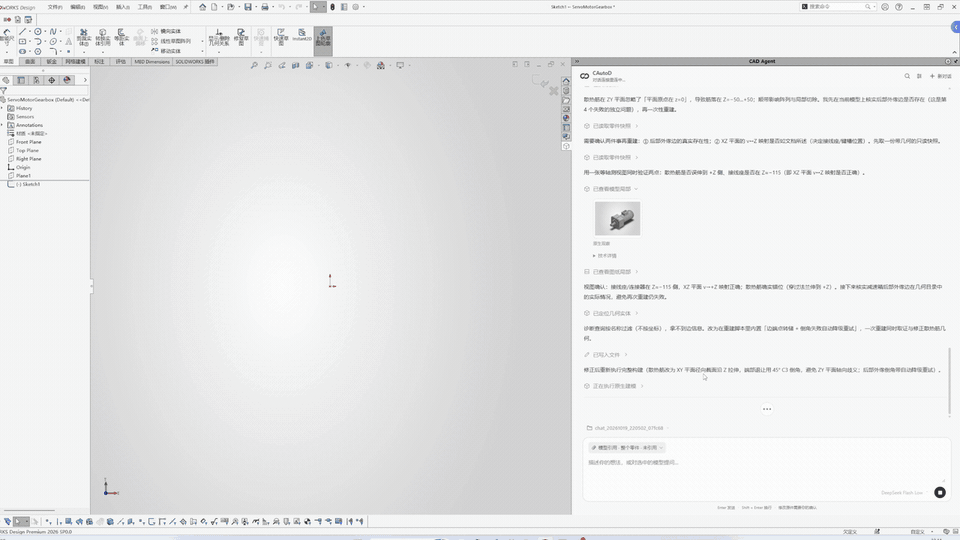
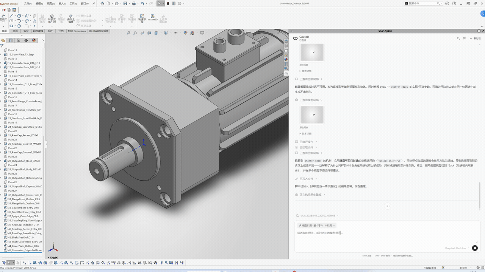
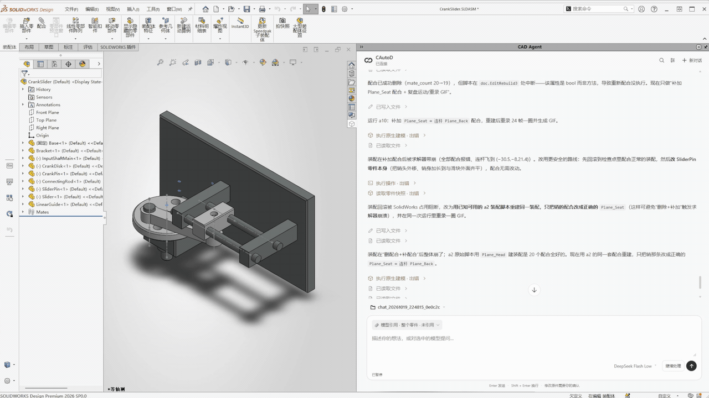
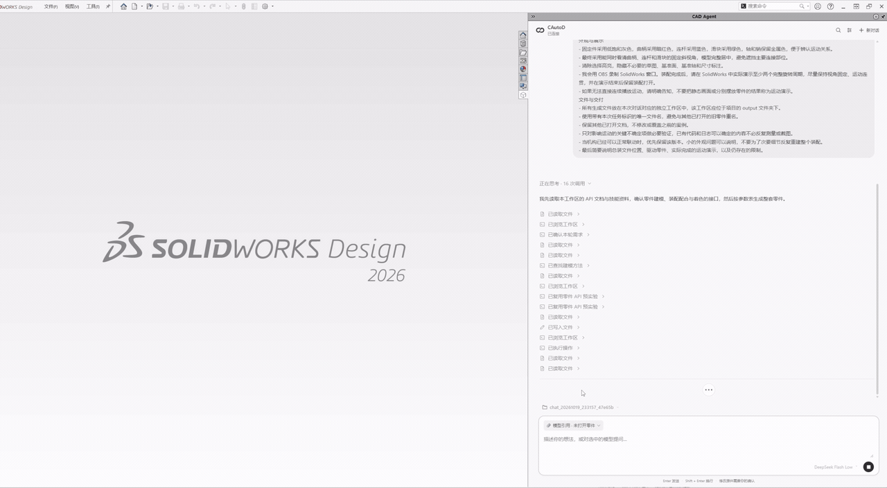
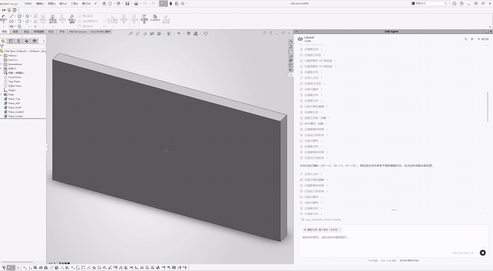

  <picture>
    <source media="(prefers-color-scheme: dark)" srcset="docs/images/cautod-symbol-light.svg">
    
  </picture>

<h1 align="center">CAutoD</h1>

<strong>从设计想法到可编辑模型，就在 SolidWorks 里。</strong>

用语言描述零件，在对话中修改，进一步构建装配。

  <a href="README.md">English</a> · 简体中文 
  <a href="https://github.com/ddhh1212/CAutoD/releases/tag/v1.0.0">下载 v1.0.0</a> ·
  <a href="#快速开始">快速开始</a> ·
  <a href="docs/INSTALL.zh-CN.md">完整安装指南</a> ·
  <a href="https://github.com/ddhh1212/CAutoD/issues">问题反馈</a>

Windows x64 · SolidWorks 插件 · 自带模型 API Key · 预览版

---

CAutoD 是运行在 SolidWorks 任务窗格里的 AI CAD agent。输入文字需求或参考图片，生成原生模型，再围绕已有结果继续修改，无需离开设计环境。

本仓库提供文档和演示。**编译后的安装包在 [Releases](https://github.com/ddhh1212/CAutoD/releases) 下载**，不需要克隆仓库，也不需要自行安装 Python 或 Node.js。

## 看看它如何工作

### 描述需求 → 生成零件

### 围绕已有零件继续修改

### 构建装配与运动展示

<strong>更多演示：独立组件 → 总装机构</strong>

**装配零件生成**

**总装构建过程**

演示均来自 OBS 录制的真实 SolidWorks 操作，以 8 倍速播放。新增两张是去除等待片段后的过程剪辑。真实会话包含迭代与修复，不代表所有任务都能一次成功；运动演示来自恢复后的可联动版本，不等于完成了全部干涉检查或工程认证。

## 能做什么

| 功能 | 使用方式 |
| --- | --- |
| **原生零件生成** | 输入文字或参考图，生成 SolidWorks 零件及特征。 |
| **局部交互修改** | 调整已有模型的孔、尺寸、倒角等细节；保留侧栏对话与适用场景的预览、应用、撤销操作。 |
| **装配与机构** | 生成独立组件，建立装配关系，并请求机构运动展示。 |
| **按需模型反馈** | 围绕关键不确定项获取几何、测量或截图，采用适合交互设计的宽松交付策略。 |
| **有限范围仿真** | 单实体线性静力分析，支持压力载荷和固定面约束，需要相应 SolidWorks Simulation 环境及许可。 |
| **独立对话工作区** | 每个新对话在 `app/output/` 下建立目录，保存模型与生成脚本。 |
| **选择模型服务商** | 配置自己的模型账号和 API Key，使用支持工具调用的模型。 |

## 快速开始

**准备环境：** Windows 10/11 x64、可正常使用的 SolidWorks、.NET Framework 4.8、[WebView2 Runtime](https://developer.microsoft.com/microsoft-edge/webview2/) 和模型 API Key。当前原生测试环境为 **SolidWorks 2026 SP0.0**，其他版本尚未逐一认证。

1. 在 [v1.0.0 Release](https://github.com/ddhh1212/CAutoD/releases/tag/v1.0.0) 下载 `CAutoD-v1.0.0-win-x64.zip`，**完整解压**到可写目录。
2. 关闭 SolidWorks，运行 `Inspect.cmd` 检查文件，再运行 `INSTALL.cmd`，允许 COM 注册所需的管理员权限。
3. 启动 SolidWorks → **工具 → 插件**，启用 **CAD Agent**。
4. 打开任务窗格，点击 **API 配置**，选择服务商，填写 Base URL、准确的模型 ID 和自己的 API Key。
5. 新建对话，输入设计需求。

安装包已带 Python 和 Node.js，不需要配置 conda、下载源码或填写开发机路径。[查看完整安装、升级和故障排查指南 →](docs/INSTALL.zh-CN.md)

> 可以先给出明确的设计目标，再逐步细化。例如：“设计一个紧凑的小电机安装支架，方便拧紧紧固件，并给出线留出空间。”

## 模型服务商

配置页提供 **DeepSeek、OpenAI、通义千问/百炼、Kimi/Moonshot、智谱 GLM、Gemini、OpenRouter** 和自定义 OpenAI 兼容入口。模型需支持 **工具调用和流式输出**。[账号入口与配置说明 →](docs/INSTALL.zh-CN.md#首次配置模型-api)

未配置时不能发送任务。保存配置不会调用模型，也不代表 Key、余额和权限已验证；发送任务后按服务商规则计费。网页聊天会员通常不包含 API 额度。

当前一次保存一个活动服务商/模型。暂不支持 Anthropic 原生 Messages 协议，Claude 可经 OpenRouter 等兼容入口使用。各服务商能力和实际兼容情况可能不同。

## 文件与密钥

- API Key 通过 **Windows 当前用户 DPAPI** 加密保存在 `%LOCALAPPDATA%\CAutoD\provider.json`，不写入系统环境变量，不回显到浏览器。
- 模型和生成脚本保留在对话工作区。任务内容、参考图与必要的工具反馈会发送给你选择的模型服务商。
- 安装包不包含开发机密钥、`.env`、签名私钥、旧对话或历史生成模型。
- 安装配置使用相对路径。移动已注册目录前，先关闭 SolidWorks 并卸载注册，再到新位置重新注册。

## 当前版本

**v1.0.0 是首个二进制预览版。** 已在本机隔离目录验证中文/空格路径迁移、编译版启动、首次配置拦截、密钥保护、SDK/文档加载和离线工具循环。第二台电脑全新安装、各服务商真实调用仍待验证。见 [发布说明](RELEASE_NOTES.md) 和 [检查结果](RELEASE_CHECKS.json)。

原生插件为 .NET DLL，后端与 PySW 实现以 Python 编译字节码分发，不附带 `.cs` / `.py` 实现文件。**字节码不是加密，不能保证无法反编译。** 前端、安装脚本、API 文档和 skill 保持可读，用户生成的建模脚本也会保留。

本次公开的是二进制发行包，不是实现源码开源。没有为项目实现代码另行赋予开源许可证；第三方组件遵循各自条款，见 [THIRD_PARTY_NOTICES.md](THIRD_PARTY_NOTICES.md)。

## 反馈问题

请在 [Issues](https://github.com/ddhh1212/CAutoD/issues) 提供 SolidWorks 版本、CAutoD 版本、服务商与模型 ID、复现步骤及脱敏后的报错片段。**不要上传 API Key、密钥配置文件或保密设计。**
